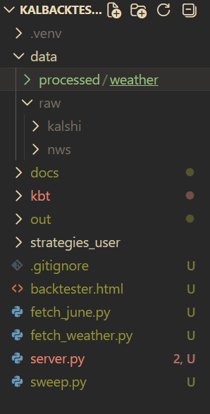
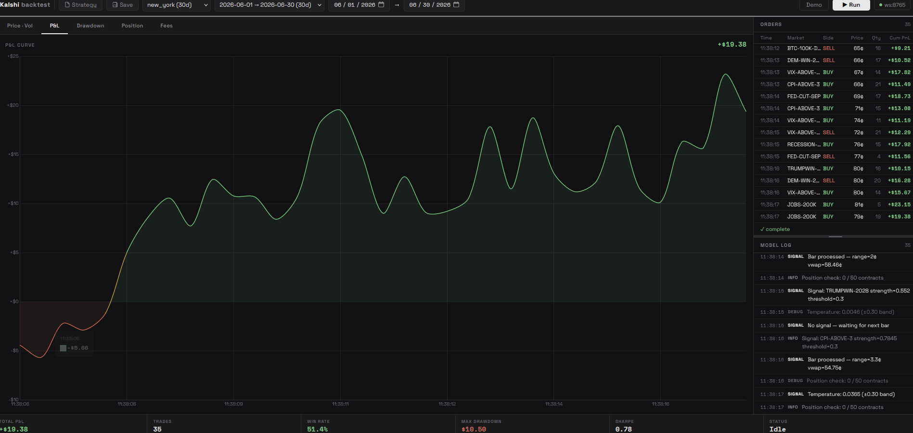
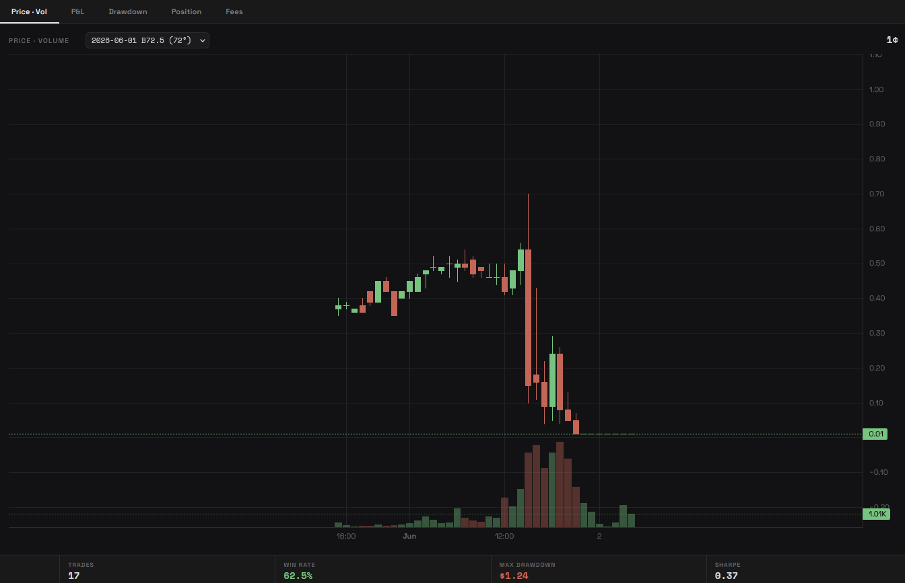
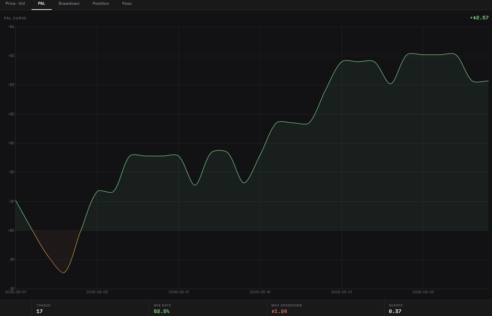
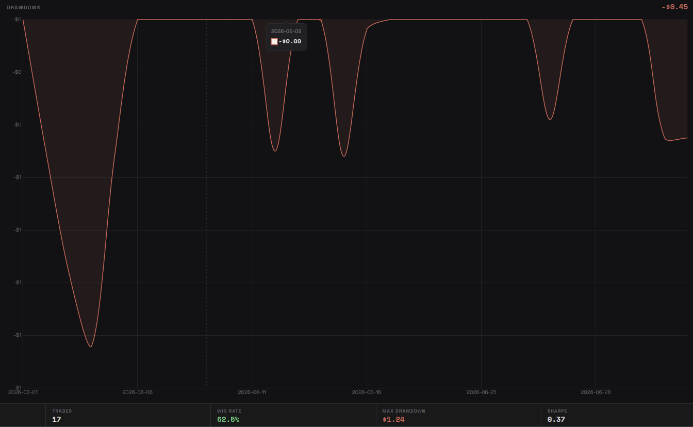
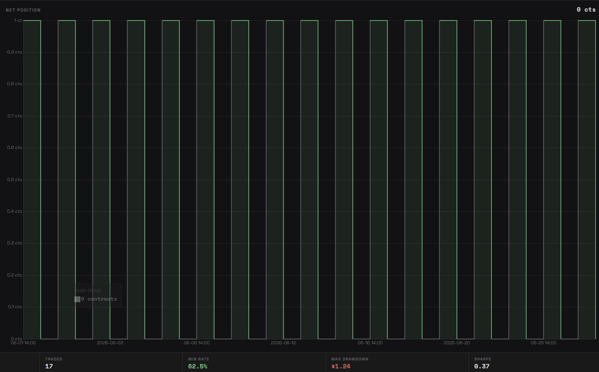
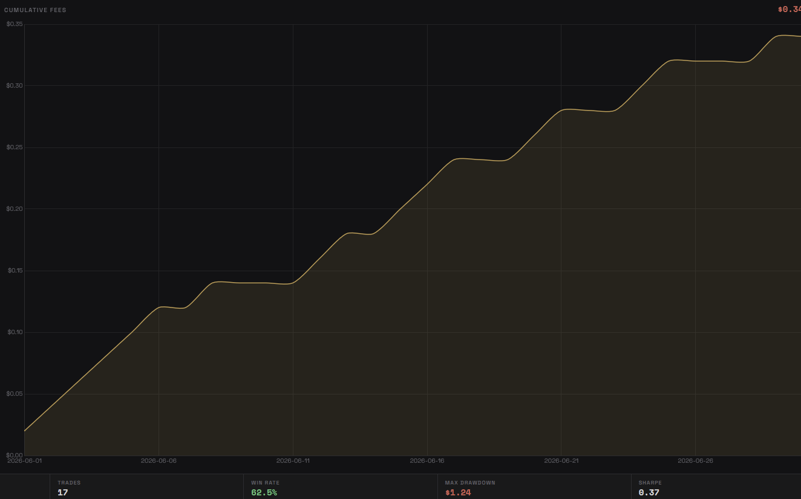

# kbt — Kalshi Weather Backtester

An event-driven backtester for Kalshi **daily-high-temperature** prediction markets
(New York, Los Angeles, Miami). It replays historical hourly candles event-day by
event-day, runs a strategy against each day's contracts, applies a settlement-aware
safety gate, fills at the book with Kalshi fees, and reports per-trade and aggregate
metrics — either from the command line or through a live web UI.

> **Strategy logic is intentionally undocumented.** The built-in strategies are
> referred to by name only. This README explains how to *run* and *evaluate* them,
> not how they decide.

---

## Contents

1. [What it does](#what-it-does)
2. [Screenshots](#screenshots)
3. [Project layout](#project-layout)
4. [Install](#install)
5. [Data pipeline](#data-pipeline)
6. [Quick start](#quick-start)
7. [Usage — CLI](#usage--cli)
8. [Usage — Web UI](#usage--web-ui)
9. [Usage — Parameter sweep](#usage--parameter-sweep)
10. [Strategies](#strategies)
11. [The safety gate](#the-safety-gate)
12. [Metrics reference](#metrics-reference)
13. [Reading results: good vs bad](#reading-results-good-vs-bad)
14. [Troubleshooting](#troubleshooting)
15. [Roadmap](#roadmap)

---

## What it does

- **Input:** Kalshi markets + hourly candles per contract, and an NWS daily-maximum
  temperature cache used by the gate.
- **Loop:** for each event-day, the engine builds the day's contracts, feeds bars to
  the strategy in time order, collects `OrderIntent`s, fills them at the book, books
  fees, and settles at expiry.
- **Output:** a metrics summary plus optional `trades.csv`, `equity.csv`, and
  `metrics.json`; or a live stream to the web UI (candles, equity, drawdown, position,
  fees, order log, model log).

All times are **UTC** internally. Kalshi daily-high markets open the day before the
event and close the following morning; the engine reads `close_time` from each
contract's `MarketSpec`.

---

## Screenshots
**Repository layout**
<br>


**Demo mode** — the full UI on synthetic data (click **Demo**, no backend needed).
A quick way to see the layout before wiring up real data.



**Price · Vol** — candlesticks for the contract chosen in the header dropdown, plus a
volume histogram. Each contract is one temperature bracket; the selector keeps the
chart to a single contract at a time.



The analysis tabs, from one real run (New York, June 2026):

**P&L** — realized cumulative equity, one point per settled day. The early dip below
zero is a real drawdown; the climb back is the "good" half of the same run.



**Drawdown** — distance below the running equity peak (how far underwater, and for how
long).



**Position** — net open contracts; sawtooths between 0 and 1 because each event settles
same-day (it no longer ladders upward).



**Fees** — cumulative Kalshi fees across the run.



---

## Project layout


```
KalBacktester/
├── kbt/                     # the engine package
│   ├── schemas.py           # Bar, MarketSpec, DayGate, EventState, OrderIntent, Trade
│   ├── contracts.py         # ticker parsing + outcome lock
│   ├── loaders.py           # load bars / markets / weather
│   ├── gate.py              # build_gate_from_max(): the safety gate
│   ├── fills.py             # fill at bid/ask + Kalshi fee
│   ├── ledger.py            # positions, realized/MTM equity curves
│   ├── engine.py            # EventDay + run_event(): the core loop
│   ├── metrics.py           # Metrics dataclass + compute_metrics()
│   ├── strategy.py          # Strategy protocol + BaseStrategy
│   ├── strategy_loader.py   # shared loader (CLI / sweep / server)
│   ├── strategies/          # built-in strategies (auto-discovered)
│   │   └── __init__.py      # scans the folder; no manual edits needed
│   ├── statespace/          # opt-in portfolio-optimization machinery
│   └── run.py               # CLI entry point
├── strategies_user/         # your own / uploaded strategy files
├── server.py                # WebSocket bridge for the web UI (ws://localhost:8765)
├── backtester.html          # the web UI (open in a browser)
├── sweep.py                 # hours × conviction grid optimizer
├── fetch_june.py            # fetch Kalshi markets + candles + NWS obs
├── fetch_weather.py         # build the NWS daily-max cache the gate reads
└── data/                    # all cached data (see Data pipeline)
```

**Adding a strategy** is just dropping a `.py` into `kbt/strategies/`. The package
`__init__.py` auto-discovers any class with an `on_event` method, so it becomes
importable and runnable with no manual edits. User-uploaded files can also live in
`strategies_user/` and be loaded by path.

---

## Install

Requirements: **Python 3.12+**, a virtual environment, and the `websockets` package
(only needed for the web UI). The CLI and sweep use the standard library plus the
engine itself.

```bash
cd ~/KalBacktester
python -m venv .venv && source .venv/bin/activate   # or use uv / your env of choice
pip install websockets
```

The data fetchers (`fetch_june.py`, `fetch_weather.py`) use only the standard library.

---

## Data pipeline

Two fetchers populate `data/`. **Both must run** before a city will produce trades:
the first supplies the markets, the second supplies the daily-max cache the gate
depends on.

### 1. Kalshi markets + candles — `fetch_june.py`

```bash
python fetch_june.py                       # all cities, June 2026 → ./data
python fetch_june.py --city los_angeles    # one city
python fetch_june.py --dry-run             # show plan, no API calls
```

Series tickers (verified against live Kalshi markets, June 2026):

| City | key | series | station |
|------|-----|--------|---------|
| New York | `new_york` | `KXHIGHNY` | KNYC |
| Los Angeles | `los_angeles` | `KXHIGHLAX` | KLAX |
| Miami | `miami` | `KXHIGHMIA` | KMIA |

> If a city returns **0 markets**, the series ticker is wrong — that is the first
> thing to check. Kalshi occasionally renames series; confirm on
> <https://kalshi.com/browse>.

### 2. NWS daily-max cache — `fetch_weather.py`

```bash
python fetch_weather.py --start 2026-06-01 --end 2026-06-30
```

This builds `data/processed/weather/<city>.json`, the trusted daily-maximum the gate
reads. **Without it, every day is BLOCKED** ("no trusted daily max") and the strategy
makes no trades. `fetch_june.py` alone does **not** create this cache.

### Data layout

```
data/
├── raw/kalshi/<city>/markets/<SERIES>.json     # all contracts for the series
├── raw/kalshi/<city>/candles/<TICKER>.json     # hourly candles per contract
├── raw/nws/<city>/observations/...             # raw NWS obs (from fetch_june)
└── processed/weather/<city>.json               # daily-max cache (from fetch_weather)
```

The web server **auto-detects** each city's series from the markets filename on disk,
so once the data is present the calendar fills in automatically.

---

## Quick start

```bash
# 1. fetch data (both fetchers)
python fetch_june.py
python fetch_weather.py --start 2026-06-01 --end 2026-06-30

# 2. a baseline backtest from the CLI
python -m kbt.run --data ./data --city new_york --series KXHIGHNY --out ./out/new_york

# 3. or the web UI
python server.py        # starts ws://localhost:8765
# then open backtester.html in a browser
```

---

## Usage — CLI

```bash
python -m kbt.run --data ./data --city new_york --series KXHIGHNY --out ./out/ny
```

| Flag | Default | Meaning |
|------|---------|---------|
| `--data` | *(required)* | path to the `data/` dir |
| `--city` | `new_york` | city key |
| `--series` | `KXHIGHNY` | Kalshi series ticker |
| `--strategy` | built-in default | strategy file (`path/to.py`) or built-in stem |
| `--qty` | `1` | contracts per order |
| `--slippage` | `0.0` | price slippage applied at fill |
| `--allow-post-max` | off | disable the safety gate (see below) |
| `--out` | none | write `metrics.json`, `trades.csv`, `equity.csv` here |
| `--verbose` | off | per-event logging |

`--strategy` accepts either a built-in (by filename stem, e.g. a name from
`kbt/strategies/`) or a path to your own file (e.g. `strategies_user/mine.py`).

---

## Usage — Web UI

Start the bridge, then open the page:

```bash
python server.py        # ws://localhost:8765
# open backtester.html
```

**Workflow:** the sidebar lists discovered strategies and the calendar of available
days per city. Pick a **city**, pick a **strategy**, set a **date range** (the date
pickers enable once a city with data is selected), then **Run**.

**Panels:**

- **Price · Vol** — candles for the contract chosen in the header dropdown, plus
  volume. Only *traded* contracts appear in the dropdown.
- **P&L** — realized cumulative equity, one point per settled event-day.
- **Drawdown** — distance below the running equity peak.
- **Position** — net open contracts; returns to zero at each settlement (so it
  sawtooths rather than climbing forever).
- **Fees** — cumulative Kalshi fees over the run.
- **Orders** — every fill: time, contract, side, price, quantity, cumulative P&L.
- **Model log** — the strategy's signal stream with its reason strings.

You can save an uploaded strategy into the library from the UI; it then appears in the
sidebar and is runnable like a built-in.

---

## Usage — Parameter sweep

`sweep.py` grids a benchmark strategy over an **hours-before-close × conviction**
surface, running a full backtest in every cell, and reports the best cell plus a CSV.

```bash
python sweep.py --data ./data --city new_york --series KXHIGHNY \
    --strategy target --conv 0.50:0.95:0.05 --out ./out/sweep.csv
```

| Flag | Default | Meaning |
|------|---------|---------|
| `--strategy` | `target` | which benchmark to sweep: `target` or `armed` |
| `--conv` | `0.50:0.95:0.05` | conviction range `start:stop:step` |
| `--qty` | `1` | contracts per order |
| `--slippage` | `0.0` | fill slippage |
| `--allow-post-max` | off | disable the gate |
| `--min-trades` | `5` | minimum trades for a cell to qualify as "best" |
| `--out` | none | write the full grid CSV |

- `--strategy target` sweeps **MiddayFadeAt**.
- `--strategy armed` sweeps **ArmedFade**.

The two modes render **different displays** suited to each strategy's behavior. The
hour axis is fixed at 0–48h. *(How each strategy interprets the swept parameters is
intentionally undocumented — see the strategy files.)*

---

## Strategies

The repo ships three built-in strategies. **They are named here and nothing more —
their decision logic is intentionally undocumented.**

| Name | Role |
|------|------|
| `HighestTempFade` | default built-in |
| `MiddayFadeAt` | benchmark (`--strategy target` in the sweep) |
| `ArmedFade` | benchmark variant (`--strategy armed` in the sweep) |

To add your own: drop a `.py` file defining a class with an `on_event(self, state)`
method into `kbt/strategies/` (auto-discovered) or `strategies_user/` (loaded by
path). A strategy returns `list[OrderIntent]`; the engine handles gating, fills,
fees, the ledger, settlement, and metrics. Nothing else is required.

### Keeping strategies private

If this repo is **public**, be aware that strategy logic leaks through several
channels, not just the README:

- the strategy **source files** (docstrings + the `reason=` strings),
- the **Orders / Model-log** panels in the UI (they print those reason strings),
- `trades.csv` if committed.

To keep your real work secret, put serious strategies in `strategies_user/` and load
them by path — the provided `.gitignore` excludes everything there except a single
example, so your alpha is never committed. The screenshots in this README were chosen
and cropped to avoid showing any reason strings or strategy signatures. If you need
the built-in benchmarks hidden too, the cleanest option is simply to make the GitHub
repo **private** (git history preserves anything pushed even once, so decide before
the first push).

---

## The safety gate

The gate is **infrastructure, not strategy** — it exists so backtests can't cheat by
trading on information that wasn't available yet. It is on by default.

- **Blanket time-stop:** once the day's maximum temperature has printed, the market
  outcome is effectively known, so the gate **blocks all entries from the bar that
  contains the max onward**. You cannot fill at or after the high.
- **Fail-closed:** if the daily max or its timing can't be trusted (missing or
  low-confidence weather data), the **entire day is BLOCKED** rather than risk a
  look-ahead fill. This is why days show `BLOCKED (no trusted daily max)` when the
  weather cache is absent.
- **Override:** `--allow-post-max` disables the blanket stop (for A/B comparison
  only — results then include physically impossible fills).

If you see many blocked days, the cause is almost always a missing or partial weather
cache — run `fetch_weather.py` for the full date range.

---

## Metrics reference

`compute_metrics()` returns (and `metrics.json` contains):

| Field | Meaning |
|-------|---------|
| `n_trades` / `n_settled` / `n_unsettled` | trade counts |
| `total_pnl` | realized P&L across settled trades |
| `win_rate` | fraction of settled trades with positive P&L |
| `avg_win` / `avg_loss` | mean win / mean loss |
| `profit_factor` | gross win ÷ gross loss (`null` if no losses) |
| `expectancy` | mean P&L per trade |
| `max_drawdown` | largest drop in the realized equity curve |
| `max_drawdown_intraday` | drawdown on the mark-to-market curve, if supplied |
| `sharpe_per_trade` | mean ÷ stdev of per-trade P&L |
| `final_equity` | reconciles with `total_pnl` (realized) |

Note: `max_drawdown` now correctly captures an opening-loss drawdown (equity starting
at 0 and going negative), and non-finite values (e.g. `profit_factor` with zero
losses) serialize as `null` so the JSON is always valid.

---

## Reading results: good vs bad

- **Good:** equity curve trends up, `profit_factor > 1`, `expectancy > 0`,
  `max_drawdown` small relative to `total_pnl`, positive `sharpe_per_trade`.
- **Bad:** equity drifts down or ends negative, `profit_factor < 1`, negative
  expectancy, or a drawdown comparable to (or larger than) total P&L.
- **In the sweep:** if the **best** cell is still ≤ \$0, the strategy is unprofitable
  across the entire grid — the sweep prints a warning when this happens. A profitable
  benchmark shows a clear region of positive cells rather than one lucky outlier.

The example equity curve above shows both within one run: a stretch underwater (bad)
followed by a recovery to positive (good). Judge a strategy by the *shape and
stability* of the whole curve, not the final number alone.

---

## Troubleshooting

| Symptom | Likely cause / fix |
|---------|--------------------|
| City shows **0 days** | Wrong series ticker, or no data fetched. Verify the series (table above) and run `fetch_june.py`. |
| Every day **BLOCKED** | Missing daily-max cache — run `fetch_weather.py` for the full range. |
| Run button does nothing | Pick a city *and* a strategy *and* a valid date range; the date pickers enable only after a city with data is selected. |
| `opening handshake failed` in server log | Benign — a non-WebSocket client touched the port. Doesn't affect runs. |
| Contract dropdown is short | Only *traded* contracts stream to the chart. Untraded strikes aren't listed (by design). |
| LA / Miami still empty after fetch | Delete any stale wrong-named market files, re-run both fetchers, restart `server.py`. |

---

## Roadmap

Ideas for later, roughly in order of usefulness:

- **All-strikes price view:** stream every bracket's candles (not only traded ones) so
  the dropdown can browse the full temperature ladder per day.
- **Strategy comparison view:** run two strategies side by side and overlay equity /
  drawdown / fees.
- **Walk-forward / out-of-sample split:** tune on one window, validate on another, to
  catch overfit sweep cells.
- **Multi-city aggregate metrics:** combine NY + LA + Miami into one portfolio curve.
- **`statespace` integration:** wire the opt-in portfolio-optimization machinery into a
  strategy that declares `requires = {"market_state"}`.
- **Export from the UI:** download `trades.csv` / `metrics.json` directly from the web
  app.

---

### Sources

Series tickers verified against live Kalshi markets (June 2026):
`KXHIGHLAX` — <https://kalshi.com/markets/kxhighlax/highest-temperature-in-los-angeles>;
`KXHIGHMIA` — <https://kalshi.com/markets/kxhighmia/highest-temperature-in-miami>.
Everything else in this README is derived from the repository's own source
(`kbt/`, `server.py`, `sweep.py`, the fetchers) as of this writing.
